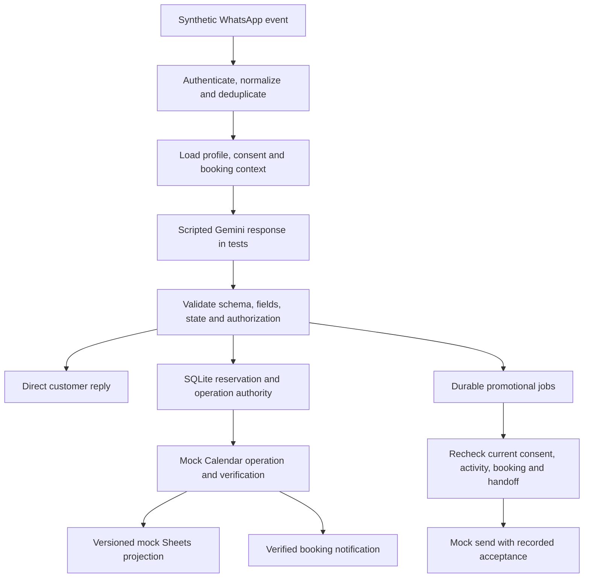

# AI Booking Automation Platform — n8n

An isolated, mock-tested booking automation project built around n8n, deterministic
application rules and SQLite. It explores how an AI assistant can interpret appointment
requests while application logic controls authorization, reservations, consent and
external-operation verification.

The current demonstration uses synthetic fitness-studio customers and one bookable
resource with capacity one. Configurable support for other appointment businesses is a
future goal. **This project is not production-ready. Live provider integrations have
not been verified. All workflow candidates remain inactive.**

> Sharing status: the existing simulation video has not been privacy-cleared. It remains
> unchanged in Git history. Do not publish or redistribute it until the review described
> in [sharing readiness](docs/sharing-readiness.md) is complete. Removing a README link
> or adding an ignore rule does not remove an already tracked video from Git.

## What the implementation demonstrates

- Validated partial customer-profile updates and separate lead/booking states.
- Strict AI response validation and deterministic booking authorization.
- Authenticated application ingress and durable message deduplication. Actual WHAPI
  signature/ingress compatibility still needs live-provider review.
- Transactional SQLite reservations, overlap protection and persistent operation records.
- Calendar-result verification before booking success; independent, versioned Sheets
  projections that cannot roll back a verified booking.
- Explicit promotional consent (`unknown`, `granted`, `revoked`), state-aware scheduled
  jobs and human handoff tracking (`None`, `Requested`, `Assigned`, `Resolved`).
- Conservative uncertainty handling: an ambiguous remote mutation or send is recorded
  and is not automatically repeated.
- Actual n8n workflow tests with synthetic data, mock integrations, virtual time,
  concurrent workers and controlled interruption/restart scenarios.

## Architecture



Gemini supplies an interpretation, not permission to execute an operation. SQLite owns
reservation identity and verified booking state. Calendar is an external appointment
integration; Sheets is a staff-facing projection. Promotional outreach has its own consent
and eligibility gate. Direct replies and transactional booking messages remain separate.
A provider accepting a message is not proof of delivery.

The optional provider adapters and inherited provider nodes are preserved for future
integration work. In the supported test path, the harness replaces external integrations
with local deterministic mocks before execution and removes credential bindings.

## Technology

| Component | Role |
|---|---|
| n8n 2.44.6 | Workflow routing, expressions and custom nodes |
| Node.js 24 / JavaScript | Validation, SQLite domain logic and Node test runner |
| SQLite | Inbox claims, reservations, projections, consent, jobs and handoffs |
| Python 3.10+ | Harness orchestration and safety checks; standard library only |
| Docker on Linux | Network-disabled, disposable test environment |
| Gemini, WHAPI, Google Calendar / Sheets | Intended external integrations; mocked in acceptance tests |

## Completed milestones and workflow exports

| Milestone | Scope | Documentation |
|---|---|---|
| M1 | Safe baseline and mock test harness | [Harness](tests/harness/README.md), [baseline](tests/harness/BASELINE.md) |
| M2 | Profile and state correctness | [Design](docs/milestone2.md), [results](docs/milestone2-results.md) |
| M3 | AI validation and action authorization | [Design](docs/milestone3.md), [results](docs/milestone3-results.md) |
| M4 | Authenticated ingress and deduplication | [Design](docs/milestone4.md), [results](docs/milestone4-results.md) |
| M5 | Reservations and verified booking operations | [Design](docs/milestone5.md), [results](docs/milestone5-results.md) |
| M6 | Consent-aware follow-ups and handoffs | [Design](docs/milestone6.md), [results](docs/milestone6-results.md) |

`workflow.json` is the preserved 46-node original prototype. It retains known defects and
is a comparison baseline, not the recommended live entry point. `workflows/milestone2.json`
through `workflows/milestone6.json` are separate inactive candidates. The latest M6
candidate has 112 nodes. Earlier candidates intentionally retain the defects associated
with their historical milestone; a passing M6 suite does not make those exports safe to
activate.

The reviewed M1–M6 implementation is preserved in local checkpoint commit
`0d9a2d02444aad13737c1e4b25cf3794851dfa3a`. Custom-node source and its dependency layout
must accompany the candidates. **Importing JSON alone is not a complete installation.**

## Safe local setup and tests

Prerequisites: Linux, Node 24, Python 3.10+, `ldd`, Docker and a locally provisioned n8n
2.44.6 installation with its SQLite native module. No provider accounts, credentials,
environment variables or real customer information are required for the mock tests.
There is no root npm application to install: the domain tests use Node built-ins.

Run the lightweight checks from the repository root:

```bash
node --test tests/*.test.js
PYTHONDONTWRITEBYTECODE=1 python3 -m unittest discover -s tests/harness -p 'test_*.py' -v
node scripts/build-milestone6.js --check
```

If the local harness runtime image has already been provisioned:

```bash
python3 tests/harness/run-milestone6.py build
python3 tests/harness/run-milestone6.py run eligible-followup
python3 tests/harness/run-milestone6.py run all
```

For a fresh machine, follow [reproducibility and custom-node setup](docs/reproducibility.md)
first. Dependency acquisition is a separate step that may require internet access;
workflow builds and test execution use local dependencies with external networking disabled.
Do not run builds and containers concurrently on a constrained Docker `vfs` installation.

The runner checks network isolation, filesystem/mount restrictions and source digests
before execution, automatically imports a generated inactive testing copy, and invokes
n8n through its CLI. It fails closed if safety checks cannot be verified. M6 runs include
an actual container restart, even when selecting a single scenario.

Reports are written to a new ignored `.harness-results/` directory. Preserve them locally;
do not commit raw execution logs, databases or credential exports. The runner cleans up
only its own disposable container and verified volume. No test command activates a live
webhook or sends real WhatsApp messages.

## Verification evidence

The completed M6 acceptance run recorded **35/35 scenarios and 35/35 assertions**, across
108 actual n8n CLI executions, including one deliberate worker interruption. At that
checkpoint, **93 unit tests and 12 safety tests passed**. These are saved mock-backed
results; see the linked milestone reports for evidence identifiers and source hashes.
They are not claims of a fresh run on another developer's machine.

Earlier suites retain documented failures: M2 17/20 scenarios, M3 29/32, M4 55/56;
M5 passes 24/24. Their remaining failures are not relabeled as passes. Integration
runner exit code 1 indicates assertion failures, and 2 indicates setup/safety failure;
M6 acceptance is expected to return 0. Live provider behavior is outside these results.

## Security and limitations

- Keep every candidate inactive. Never attach production credentials for a demonstration.
- n8n exports retain credential reference IDs/names and workflow metadata. References are
  not credential values, but review and sanitize public demonstration copies separately.
- Read [sharing readiness](docs/sharing-readiness.md) before publication. The new ignore
  rules do not sanitize tracked files, old commits or video/audio content.
- OAuth, actual provider payloads, WHAPI policies, live Gemini output, delivery and native
  schedule activation remain unverified. Native Agent/memory behavior is replaced in tests.
- SQLite is a single-host authority with capacity one in the current demonstration.
  External Calendar writers bypassing that authority remain a residual conflict risk.
- The scheduler supports one same-day sending interval and processes one job per tick.
  A committed opt-out blocks later authorization; an already authorized in-flight request
  cannot be recalled. Uncertain sends are never blindly retried.
- n8n's top-level version is pinned, but transitive dependencies are not locked in this
  repository. Exact cross-machine runtime reproduction is not established.
- The test harness is not a production deployment package. Custom-node installation and
  operational access controls need separate review before any live deployment.

## Roadmap

Completed work ends at M6. Proposed next work is M7 observability and bounded recovery,
followed by M8 portfolio/demo packaging, subject to separate scope approval. Broader
business configuration and multi-tenant operation remain future directions. No M7 or M8
implementation, deployment, publication or live activation is included here.
